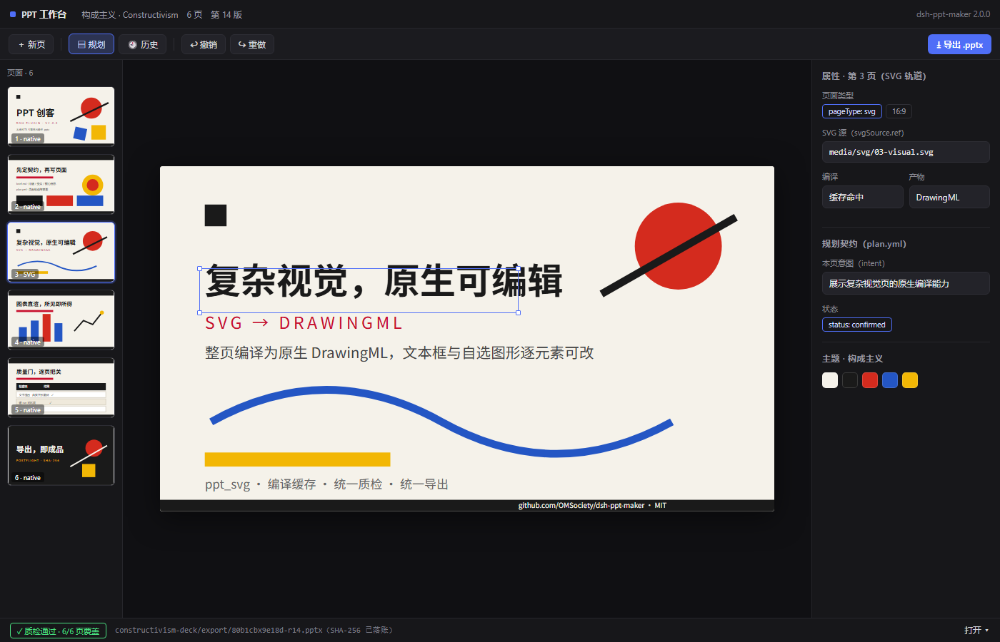

<p align="center"><strong>中文</strong> · <a href="README_en.md">English</a></p>

<div align="center">
<h1><br>PPT 创客 dsh-ppt-maker</h1>

  <p>创建 / 编辑 / 逆向 / 质检 / 导出 PPT 的 DeepSeek Harness 插件，本地纯 TS 引擎直出最终 .pptx。</p>
  <p>模型用十三个 <code>ppt_*</code> 工具干活，你在右侧栏工作台里同看同改——双击文字就地编辑、拖拽调页序、导出后一键打开成品。</p>

  <p>
    <a href="https://www.npmjs.com/package/dsh-ppt-maker"></a>
    <a href="https://github.com/deepseek-ai/dsh"></a>
    <a href="LICENSE"></a>
    <a href="https://github.com/OMSociety/dsh-ppt-maker/stargazers"></a>
    <a href="https://github.com/OMSociety/dsh-ppt-maker/issues"></a>
  </p>

<a href="#这是什么">这是什么</a> • <a href="#核心特性">核心特性</a> • <a href="#效果">效果</a> • <a href="#安装方式">安装方式</a> • <a href="#模型工具">模型工具</a> • <a href="#工作台">工作台</a> • <a href="#开发">开发</a> • <a href="#更新日志">更新日志</a> • <a href="#支持与致谢">支持与致谢</a> • <a href="#许可证与作者">许可证与作者</a>
</div>

## 这是什么

**PPT 创客**是一套长在 DeepSeek Harness 里的 PPT 工作链：模型通过十三个 `ppt_*` 工具创建、编辑、逆向、质检、导出演示文稿；人通过右侧栏工作台与模型接力——面板与模型读写同一份 PPTD 工程。

中间的格式是自主契约的 YAML DSL **PPTD**（`deck.pptd` + `pages/*.page`）：单页自包含、可视即所得，双方言（generate 生成 / reverse 逆向超集），完整规格见 [`docs/pptd-spec.md`](docs/pptd-spec.md)（全量自包含）。

## 核心特性

| 特性 | 说明 |
|---|---|
| **十三个模型工具** | raw JSON-Schema 注册：创建 / 主题 / 规划 / 编辑 / 撤销 / 重做 / 渲染 / 质检 / 导出 / 逆向 / 打开 / 外科手术 / SVG。引擎 `@office-kit/pptx@0.24.0` 本地纯 TS 构建最终 .pptx，主链无 Python |
| **规划契约** | `brief.md`（用途/受众/核心信息）+ `plan.yml`（页面规划：轨道/意图）是工程一等产物；`ppt_plan` 读写，工作台规划抽屉同看；P01–P05 早期页先渲染确认再铺开全量 |
| **SVG 页面轨** | `pageType: svg` 的页整页编译为原生 DrawingML（文本框/自选图形，PowerPoint 里逐元素可编辑，非贴图），与普通页统一构建、质检、导出；`ppt_svg` 写入与编译，产物按内容+版本+主题哈希缓存。转换器 vendored 自 ppt-master（MIT），环境 `node scripts/prepare-vendor-env.mjs` 一键备好 |
| **母版与版式** | `deck.masters` 声明真实 OOXML 母版/版式（共享装饰 + 占位框），页用 `layoutRef` 挂接，多页 deck 共享装饰不必逐页重复 |
| **双向性** | `ppt_import` 把既有 .pptx 全量逆向进 PPTD 工程并原样存档源文件；自导入后零编辑的 deck 导出时整份从源存档恢复（chart/SmartArt/连接器不丢），任何内容编辑即整份回退重建；`ppt_patch` 对 .pptx 外科手术（改字 / 换图 / 调页序），不走 PPTD 往返 |
| **PPTD 契约** | YAML DSL（`deck.pptd` + `pages/*.page`），单页自包含、可视即所得；generate / reverse 双方言，可手改也可机改 |
| **右侧栏工作台** | 自研三栏编辑器（缩略图 + 画布 + 属性面板）：双击文字就地改、拖拽调页序、图片一键替换、table/chart 直渲、SVG 页整页预览、规划抽屉、QA 状态徽标、撤销 / 重做、版本历史直渲快照并一键恢复、409 冲突保护与「外部已修改」提示 |
| **质检分层** | 规则层（文字溢出按真实字形宽度量测 / 出界 / 重叠 / 逐 run 对比度 / 结构 / 缺字体）阻断导出；AI 层按需（`ppt_check ai:true`）把成品页 PNG 送多模态模型审配色与版式，只出建议不阻断；结果落账 `manifest.qaReport`，指纹绑定 deck+pages+plan+media+检查器与转换器版本，过期或未覆盖全页即拒导出 |
| **统一发布管线** | 模型导出与面板导出同一条 release 管线：QA 门禁 → 构建 + 字体嵌入 → postflight 回读（ZIP 重解析 + 库级校验）→ SHA-256 落账 |
| **字体嵌入** | 导出自动嵌入实际用到的字体（EOT 封装 `fntdata` + `embeddedFontLst`），未装字体的机器渲染不回落；子集 / 整字体 / 关闭三档（`export.fontEmbed`），逐字体 fsType 许可闸 |
| **转场与动画** | 页面级转场（fade 默认 / none / auto 策展轮换）与 95 种元素动画 preset，本地链路原生写出 |
| **修订与快照** | manifest 单一写者 + append-only 快照（游标模型，undo/redo 天然成立）+ baseRevision 乐观锁（409） |
| **设计系统** | 学术 / 咨询 / 金融 / 促销 / 工作五族 30 套预设主题，机器可读 `theme.yml`（颜色/字体）选题即写入 `deck.theme`，整套版式配色层级一致 |
| **本地渲染预览** | 面板画布与缩略图把 PPTD 页直接渲染成 DOM（矢量、秒出、与选择框同源同坐标系）；导出与质检的 PNG 预览走 `@deepseek-ai/libreoffice-kit` 光栅化最终 pptx，每页按 (page, revision) 磁盘缓存；`ppt_render` 在宿主支持时随结果直接返回图片内容块 |

## 效果



工作台三栏：缩略图 + 画布 + 属性面板。图中第 3 页为 SVG 轨道页（整页编译为原生 DrawingML），工具栏「规划」打开规划抽屉，状态栏 QA 徽标显示「质检通过 · 8/8 页覆盖」。预览图源文件为 [`docs/preview/workbench.html`](docs/preview/workbench.html)（HTML 仿真，可复用改字重新出图）。

## 安装方式

**从 npm 安装**

```powershell
# 先停掉正在运行的 DSH（运行中的服务会锁住依赖，装完再起）
dsh plugin --profile <profile> add "dsh-ppt-maker"
```

> **提示**：装好后**刷新一下浏览器页面**，从右侧栏打开「PPT 工作台」——只重启宿主不够，客户端产物是页面加载时取的。

> **依赖：**主链全 TS、无 Python；`ppt_render` 与质检用的 `@deepseek-ai/libreoffice-kit@0.1.2` 是硬依赖（约 183MB/平台，随包安装）。仅当用到 SVG 页面轨（`ppt_svg`）时需要 Python 3.10+：跑一次 `node scripts/prepare-vendor-env.mjs` 自动建虚拟环境并装好 pin 依赖（pip 走默认源，可按需加镜像）。`skills/ppt-maker/scripts/` 下的 Python 脚本仅作逃生舱，见 SKILL.md「Python 逃生舱」。

> **平台：**引擎按平台分发——Windows（x64/arm64）与 macOS（x64/arm64）用原生包，Linux 没有原生包（npm 上不存在 `libreoffice-kit-linux-*`），渲染与质检改走 WASM。CI 在 `windows-latest` 与 `ubuntu-latest` 上跑同一套用例（字体嵌入断言除外），两个平台都通过；导出产物同源，未做跨平台逐字节对比。macOS 目前没有 CI 覆盖。

**装完怎么用**

1. 对话里说「帮我做一份 PPT」（或显式 invoke `ppt-maker` 技能）→ 十三个 `ppt_*` 工具进场
2. 模型 `ppt_plan` 写下 brief 与页面规划（P01–P05 早期页先渲染给你过目），`ppt_create` 新建工程，或 `ppt_import` 把现有 .pptx 逆向进工程 → 右侧栏自动弹出工作台
3. 面板里双击文字就地改、拖页序、点「导出 .pptx」→ 成品落在工程目录 `export/`（文件名带版本号）
4. 让模型 `ppt_check` 质检、`ppt_render` 逐页看 PNG；模型在别的会话改了同一工程，面板亮 409 冲突条，不覆盖你的手改
5. 页脚状态条点「打开」→ 用系统关联应用打开成品，或选「显示文件位置」

## 模型工具

| 工具 | 作用 | 关键参数 |
|---|---|---|
| `ppt_create` | 新建 PPTD 工程（选定主题写入 `deck.theme`） | `dir` · `title` · `size` · `designSystem` · `theme` |
| `ppt_themes` | 列设计系统与主题（五族 30 套） | `designSystem`（可省） |
| `ppt_plan` | 读写规划契约：brief（用途/受众/核心信息）与 plan（页面规划） | `dir` · `action`（`get`/`setBrief`/`setPlan`） |
| `ppt_edit` | 原子编辑：ops 数组批量增删改页面与元素（含 `update_plan`/`update_svg_source`），baseRevision 乐观锁 | `dir` · `ops` · `baseRevision` |
| `ppt_undo` / `ppt_redo` | 撤销 / 重做（游标移动，合并窗内连续编辑算一步） | `dir` · `steps`（1–20，默认 1） |
| `ppt_render` | 渲染每页 PNG 预览（最终 pptx 光栅化；宿主支持时随结果返回图片内容块） | `dir` · `pages` · `dpi`（默认 96） |
| `ppt_check` | 规则质检（默认）+ AI 视觉质检（只出建议不阻断） | `dir` · `pages` · `ai` |
| `ppt_export` | 导出 .pptx（QA 指纹门禁 + postflight 回读，`skipCheck` 绕过） | `dir` · `out` · `skipCheck` |
| `ppt_import` | .pptx → PPTD 全量逆向（dropped / degraded 两级报告 + 源文件存档） | `source` · `targetDir` · `mode`（`full` / `surgical`）· `open` |
| `ppt_open` | 让右侧栏工作台打开指定工程 | `dir` |
| `ppt_patch` | 对 .pptx 外科手术：set_text / replace_image / move_page | `source` · `ops` · `out` |
| `ppt_svg` | SVG 页面轨：写入 SVG 源（`put`）/ 编译为原生 DrawingML 单页（`compile`） | `dir` · `action` · `name` · `svg` · `page` |

模型的标准动作顺序是 **`ppt_plan`（写 brief/plan）→ `ppt_create`（或 `ppt_import`）→ `ppt_edit` 迭代（复杂视觉页走 `ppt_svg`）→ `ppt_check` → `ppt_export`**；技能 `ppt-maker`（随插件注册）写明了设计系统选型与编辑纪律，模型需要时会自己读。轻改既有 .pptx（改字 / 换图 / 调页序）走 `ppt_patch`，不经 PPTD 往返。

> **提示：**导出被规则 blocker 拦住时，按 `ppt_check` 返回的 `issues` 逐条修，或 `skipCheck:true` 强导（不推荐）。`ppt_check ai:true` 返回 `ai.performed:false` 加 PNG 路径清单时，说明当前路由模型不支持图像输入，主模型自行 `read_image` 复核即可。

## 工作台

右侧栏「PPT 工作台」是三栏编辑器：缩略图条 + 画布 + 属性面板。

- **底图即 DOM**：画布与缩略图把 PPTD 页 AST 直接渲染成 DOM（`client/components/PptdView.tsx`），打开即出、无需等 libreoffice 冷启动；元素、选择框、就地编辑器同一坐标系，恒对齐。table / chart 直渲为真实 DOM/SVG；SVG 页整页铺底预览；icon / SmartArt 等暂不支持渲染的元素显示灰底占位。
- **规划抽屉**：工具栏「规划」打开只读抽屉，看 brief.md 与 plan.yml（页文件/标题/轨道/意图）。
- **QA 徽标**：状态栏显示质检落账状态——通过 / 未过（阻断数）/ 已过期（revision 对不上）。
- **左右栏可收缩**：左栏页列表默认展开、可收起；右栏属性面板选中元素才展开。收起态只留边缘把手。
- **就地编辑**：双击文字就地改 / 拖拽调页序 / 复制删除新增页 / 替换图片 / 「导出 .pptx」落到工程目录 `export/` 下（文件名带版本号）。
- **版本历史**：「历史」抽屉直渲任意快照的画布预览并一键恢复。
- **页脚状态条**：「正在保存…」与操作反馈（导出落点、失败原因）常驻底栏，不挤压画布高度。
- **冲突保护**：所有写入带 `baseRevision`；模型在另一个会话里改了同一工程会回 409——面板只亮冲突条，不覆盖人的手改；「外部已修改」提示同理。
- **轮询与聚焦**：每 3s 拉一次状态看 manifest.revision；模型 `ppt_open` / `ppt_import` 完成后面板自动聚焦到对应工程。

## 开发

```powershell
npm install          # 安装依赖
npm test             # 全量回归（先设 12GB 堆并串行跑，见下）
npm run typecheck    # src/ 与 client/ 两份 tsconfig
npm run build        # 重出 lib/index.js 与 lib/client.js（改完 src/ 或 client/ 必跑，并提交产物）
npm run check:build  # 确认 lib/ 与 git 一致
npm run check:mounts # 挂载声明核对
```

> **提示：**全量测试需大堆串行跑（默认堆会 OOM）：先 `$env:NODE_OPTIONS='--max-old-space-size=12288'`，再 `npm test -- --no-file-parallelism`。完整验收口径与禁止事项见 [`AGENTS.md`](AGENTS.md)。

目录与「改东西去哪」：

```text
src/index.ts       宿主入口：注册技能 + 懒展开 13 个工具 + webServer 前缀路由
src/core/          引擎：pptd 契约 / officekit 构建 / 工程存储与快照 / 逆向 / 质检 / 字体嵌入 / release 发布管线 / svg 编译桥
src/tools/         13 个工具的 raw JSON-Schema 契约
client/            右侧栏工作台源码（TSX → esbuild 打成 lib/client.js）
plugin/            装载壳 + host 路由（纯 JS，经 deps.core 注入 core）
skills/ppt-maker/  ppt-maker 技能：设计系统参考与生成纪律（模型自己会读）；vendor/ 下是 SVG 转换器与 Python 环境
tests/             宿主契约 / 工具 e2e / 逆向 / 字体 / bundle 守卫（语料 .pptx 不入库）
docs/              PPTD 规格（全量自包含）/ 决策登记 / 兜底字体表
lib/               构建产物（入库；dsh plugin add 只装不构建）
```

## 更新日志

参见 [CHANGELOG.md](CHANGELOG.md)。

## 支持与致谢

- 如果这个插件对你有帮助，欢迎点亮 Star；有问题和建议请提交 [Issue](https://github.com/OMSociety/dsh-ppt-maker/issues) 或 [Pull Request](https://github.com/OMSociety/dsh-ppt-maker/pulls)，开发约定见 [`AGENTS.md`](AGENTS.md)。
- 基于 [DeepSeek Harness](https://github.com/deepseek-ai/dsh) 插件 / 技能体系。
- 引擎 [@office-kit/pptx](https://www.npmjs.com/package/@office-kit/pptx)（0.24.0 pin）与预览 [@office-kit/pptx-preview](https://www.npmjs.com/package/@office-kit/pptx-preview)；光栅化 [@deepseek-ai/libreoffice-kit](https://www.npmjs.com/package/@deepseek-ai/libreoffice-kit)（MPL-2.0，仅调用其 API / CLI，不链改源码）。
- SVG → DrawingML 转换器 vendored 自 [ppt-master](https://github.com/hugohe3/ppt-master)（MIT，© 2025-2026 Hugo He），规划契约与质量门的工作流设计亦受其启发；第三方许可明细见 [THIRD_PARTY_NOTICES.md](THIRD_PARTY_NOTICES.md)。

## 许可证与作者

[MIT](LICENSE)。© 2026 [OMSociety](https://github.com/OMSociety)。
