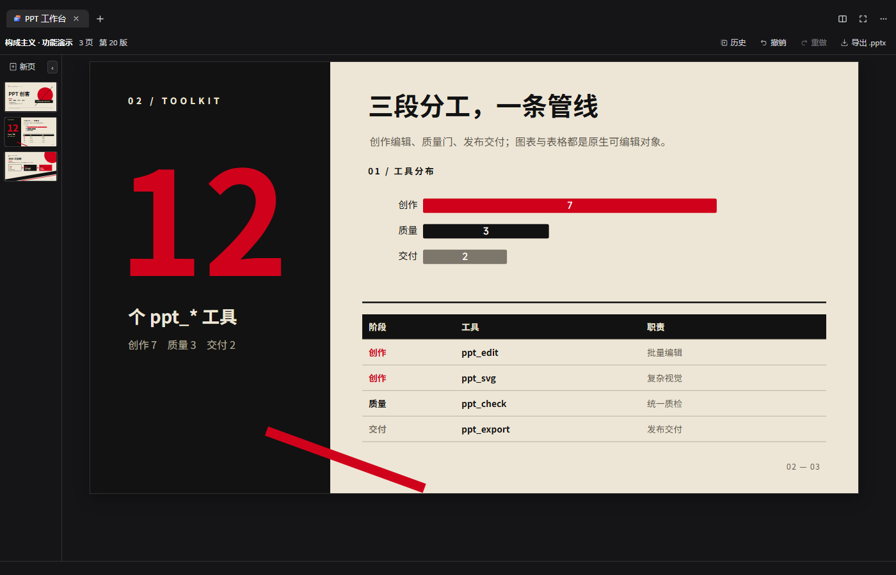
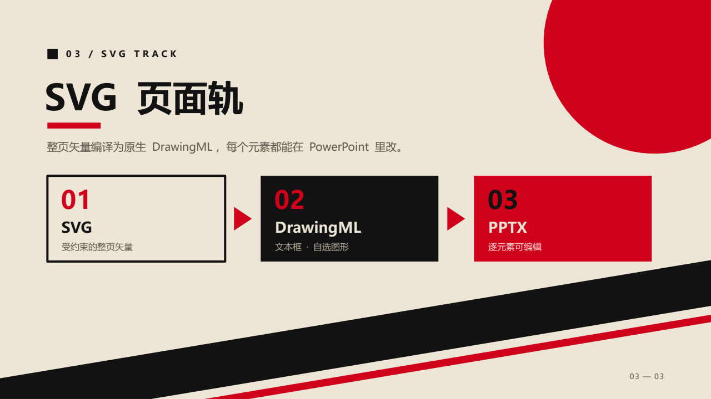

<p align="center"><strong>中文</strong> · <a href="README_en.md">English</a></p>

<div align="center">
<h1><br>PPT 创客 DSH PPT Maker</h1>

  <p>DeepSeek Harness 的演示文稿插件：模型设计、生成、重做 PPT，你在右侧栏和它一起看、一起改。</p>
  <p>成品是本地构建的 .pptx，每个字、每个形状、每张图表都能在 PowerPoint 里直接编辑。</p>

  <p>
    <a href="https://www.npmjs.com/package/dsh-ppt-maker"></a>
    <a href="https://github.com/deepseek-ai/dsh"></a>
    <a href="LICENSE"></a>
    <a href="https://github.com/OMSociety/dsh-ppt-maker/stargazers"></a>
    <a href="https://github.com/OMSociety/dsh-ppt-maker/issues"></a>
  </p>

<a href="#这是什么">这是什么</a> • <a href="#效果">效果</a> • <a href="#快速开始">快速开始</a> • <a href="#做一份新的-ppt">做一份新的 PPT</a> • <a href="#改已有的-ppt">改已有的 PPT</a> • <a href="#ppt-工作台">PPT 工作台</a> • <a href="#模型工具">模型工具</a> • <a href="#开发">开发</a> • <a href="#更新日志">更新日志</a> • <a href="#支持与致谢">支持与致谢</a> • <a href="#许可证与作者">许可证与作者</a>
</div>

## 这是什么

**PPT 创客**把「做 PPT」拆成模型和人都能接手的一条工作链。模型通过十二个 `ppt_*` 工具建工程、写页面、渲染出真实成品图来自查、跑质检、导出；你在右侧栏的「PPT 工作台」里看到同一份工程，可以随时双击改字、拖页序、换图，改完模型接着做。

页面写在 **PPTD** 里：一种 YAML 格式的工程（`deck.pptd` 加每页一个 `pages/*.page`），人能读、模型能写，完整规格见 [`docs/pptd-spec.md`](docs/pptd-spec.md)。导出时插件用 [@office-kit/pptx](https://www.npmjs.com/package/@office-kit/pptx) 在本地构建最终 .pptx，并嵌入用到的字体，对方电脑没装这些字体也能正常显示。

插件同时附带 `ppt-maker` 技能，里面有学术、咨询、金融、促销、工作五族共 30 套设计系统，以及写页面的要点，模型需要时会自己读。

## 效果

### 浅色工作台 · 封面页


### 深色工作台 · 原生图表与表格



### 实际导出 · SVG 页面



## 快速开始

先停掉正在运行的 DSH，执行 `dsh plugin --profile <profile> add "dsh-ppt-maker"` 安装，再启动 DSH。

> **提示**：装好后刷新浏览器页面，右侧栏才会出现「PPT 工作台」。工作台的界面是页面加载时取的，只重启宿主不够。

1. 在对话里说「帮我做一份关于某某的 PPT」，或者把一份现有的 .pptx 交给模型，说明要怎么改。
2. 模型新建或导入工程后，右侧栏会自动打开工作台。
3. 模型边做边渲染每一页的真实成品图自查；你随时可以在工作台里直接改，模型下一步会读到你的改动。
4. 满意后让模型导出，或在工作台点「导出 .pptx」。导出前会自动跑一遍全页质检，有阻断问题会列出来。
5. 页脚状态条的「打开」用系统关联的应用打开成品，也可以选「显示文件位置」。

> **依赖**：渲染与质检用到的 [@deepseek-ai/libreoffice-kit](https://www.npmjs.com/package/@deepseek-ai/libreoffice-kit) 随插件安装（每个平台约 183MB）。只有用到 SVG 页面时才需要 Python 3.10+：首次使用时运行一次 `node scripts/prepare-vendor-env.mjs`（在插件包根目录），它会建好虚拟环境并装齐依赖；pip 默认用清华源，可用环境变量 `PIP_INDEX` 换源、`PYTHON` 指定解释器。

> **平台**：Windows 与 macOS（x64/arm64）使用原生渲染引擎；Linux 没有原生包，渲染与质检使用 WASM 引擎。CI 在 `windows-latest` 与 `ubuntu-latest` 上跑同一套测试，macOS 暂无 CI 覆盖。

## 做一份新的 PPT

模型选好设计系统后，`ppt_create` 会把它的配色、字体和文字样式写进工程的主题表，页面里用 `$primary`、`$title` 这类引用，整套改色只需改主题表。共享的品牌色条、页脚、角标写进母版与版式，每页挂接即可。

页面元素有文字、形状（177 个预设形状及调整参数，也可以用路径自绘）、线条、图片、表格和原生图表（条形、柱形、折线、面积、饼图、环形图等，导出后在 PowerPoint 里仍可编辑数据）。文字支持渐变、描边、阴影、字间距、分散对齐和精确的内边距；形状支持渐变与图案填充、渐变描边、投影；元素可以编成组合，导出后在 PowerPoint 里整体拖动。

画面复杂到这些元素难以表达时（精细渐变、自由曲线、多层叠加的封面），可以把整页画成一份 SVG。导出时这一页会被编译成 PowerPoint 原生的文本框与形状，而不是一张贴图，打开后仍能逐个选中修改。

模型每改一轮都可以用 `ppt_render` 渲染出最终 .pptx 的真实图片自查，不是示意图。导出时 `ppt_export` 还能同时生成一份 PDF。

## 改已有的 PPT

- **只改几个字、换张图、调页序**：`ppt_patch` 直接改原文件，没碰到的部分原样保留，包括插件不建模的 SmartArt、嵌入表格等部件。
- **大改或重新设计**：`ppt_import` 把 .pptx 转成 PPTD 工程。常见的原生图表会变成可编辑的图表元素，SmartArt 展开成一组可编辑形状，组合关系、文字效果、渐变与图案填充都会保留。导入报告会列出没能转换的对象（如 OLE、媒体、少见图表类型，原位放占位）和转换时有损失的属性，模型会如实告诉你。
- **导出以原文件为骨架**：没改过的页原样沿用；改过的页按工程重建，并挂回原来的版式，页上没能转换的对象会从原文件拷回原位。主题与母版都来自原文件。

## PPT 工作台

右侧栏「PPT 工作台」是三栏编辑器：左边页面缩略图，中间画布，右边属性面板。

- **打开即看**：画布和缩略图把页面直接画成网页元素，不用等渲染引擎启动；表格、图表、SVG 页都按真实样子显示，导入时没能转换的对象，有预览图的显示预览图，没有的显示占位框。
- **直接改**：双击文字就地编辑，拖拽调页序，复制、删除、新增页面，替换图片，在属性面板里精确改位置和尺寸。
- **撤销与历史**：撤销、重做随手可用；「历史」抽屉能预览任意一个版本的画面，并一键恢复。
- **不会互相覆盖**：每次写入都带版本号。模型在别处改了同一个工程时，工作台会亮出冲突提示，不会覆盖你的手改。
- **导出**：「导出 .pptx」会先跑一遍全页质检，通过后把成品存到工程目录的 `export/` 下，文件名为 `<工程名>-r<版本号>.pptx`。

## 模型工具

| 工具 | 作用 | 关键参数 |
|---|---|---|
| `ppt_create` | 新建工程，选定的设计系统写进主题表 | `dir` · `title` · `size` · `designSystem` · `theme` |
| `ppt_themes` | 列出内置设计系统 | `designSystem`（可省） |
| `ppt_edit` | 批量原子编辑页面与元素，任一操作失败则整批不落盘 | `dir` · `ops` · `baseRevision` |
| `ppt_undo` / `ppt_redo` | 撤销 / 重做 | `dir` · `baseRevision` · `steps` |
| `ppt_svg` | 写入 SVG 页面源并挂页，或立即编译检查 | `dir` · `action` · `name` · `svg` · `page` |
| `ppt_render` | 构建最终 .pptx 并渲染每页 PNG，返回每张图的绝对路径 | `dir` · `pages` · `dpi` |
| `ppt_check` | 规则质检；`ai: true` 追加多模态视觉建议 | `dir` · `pages` · `ai` |
| `ppt_export` | 导出 .pptx，可同时导出 PDF | `dir` · `out` · `pdf` · `skipCheck` |
| `ppt_import` | 把 .pptx 转成 PPTD 工程，附导入报告 | `source` · `targetDir` · `mode` · `open` |
| `ppt_patch` | 对 .pptx 做轻改：改字、换图、调页序 | `source` · `ops` · `out` |
| `ppt_open` | 在右侧栏工作台打开指定工程 | `dir` |

规则质检会按工程实际字体的真实字形量宽，查文字溢出、出界、重叠、对比度、结构和缺字体，溢出、出界、结构损坏会阻断导出。质检结果和工程内容绑定，质检之后工程再有改动，导出会要求重新质检。导出时插件嵌入字体（子集、整字体、不嵌入三档，按字体许可逐款判定），再把成品重新解析校验一遍，校验不通过就不落盘。

> **提示**：`ppt_check` 带 `ai: true` 时，如果当前模型不支持图像输入，会返回每页图片的路径清单，由主模型自己看图复核。

## 开发

```powershell
npm install           # 安装依赖
npm run typecheck     # src/ 与 client/ 两份 tsconfig
npm run build         # 重出 lib/index.js 与 lib/client.js（改完 src/ 或 client/ 必跑，并提交产物）
npm run build:preview # 用正式工作台组件重建自包含预览页 docs/preview/workbench.html
npm run check:build   # 确认 lib/ 与 git 一致
npm run check:mounts  # 挂载声明核对
npm run check:pack    # 发布物清单核对
```

> **提示**：全量测试要用大堆串行跑：先 `$env:NODE_OPTIONS='--max-old-space-size=12288'`，再 `npx vitest run --no-file-parallelism`。完整的验收口径与开发约定见 [`AGENTS.md`](AGENTS.md)。

```text
src/index.ts       宿主入口：注册技能、十二个工具与工作台的 webServer 路由
src/core/          引擎：PPTD 契约、.pptx 构建、工程存储与版本快照、逆向导入、质检、字体嵌入、发布管线、SVG 编译
src/tools/         十二个工具的 JSON Schema 契约
client/            工作台源码（TSX，构建为 lib/client.js）
plugin/            装载壳与工作台的宿主路由
skills/ppt-maker/  ppt-maker 技能：设计系统、写页面的要点；vendor/ 下是 SVG 转换器与它的 Python 依赖
tests/             宿主契约、工具端到端、逆向导入、字体、构建产物守卫；附 20 份脱敏语料 .pptx
docs/              PPTD 规格、设计决策、兜底字体表、预览页
lib/               构建产物（入库，安装时不再构建）
```

## 更新日志

参见 [CHANGELOG.md](CHANGELOG.md)。

## 支持与致谢

- 如果这个插件对你有帮助，欢迎点亮 Star；问题和建议请提交 [Issue](https://github.com/OMSociety/dsh-ppt-maker/issues) 或 [Pull Request](https://github.com/OMSociety/dsh-ppt-maker/pulls)。
- 基于 [DeepSeek Harness](https://github.com/deepseek-ai/dsh) 的插件与技能体系。
- .pptx 构建用 [@office-kit/pptx](https://www.npmjs.com/package/@office-kit/pptx)，文字量宽用 [@office-kit/pptx-preview](https://www.npmjs.com/package/@office-kit/pptx-preview)，渲染用 [@deepseek-ai/libreoffice-kit](https://www.npmjs.com/package/@deepseek-ai/libreoffice-kit)（MPL-2.0，只调用其 API，不修改源码）。
- SVG 转换器源自 [ppt-master](https://github.com/hugohe3/ppt-master)（MIT，© 2025-2026 Hugo He），由本仓库独立维护；第三方许可明细见 [THIRD_PARTY_NOTICES.md](THIRD_PARTY_NOTICES.md)。

## 许可证与作者

[MIT](LICENSE)。© 2026 [OMSociety](https://github.com/OMSociety)。
