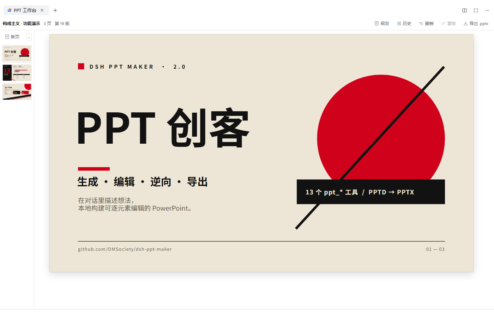
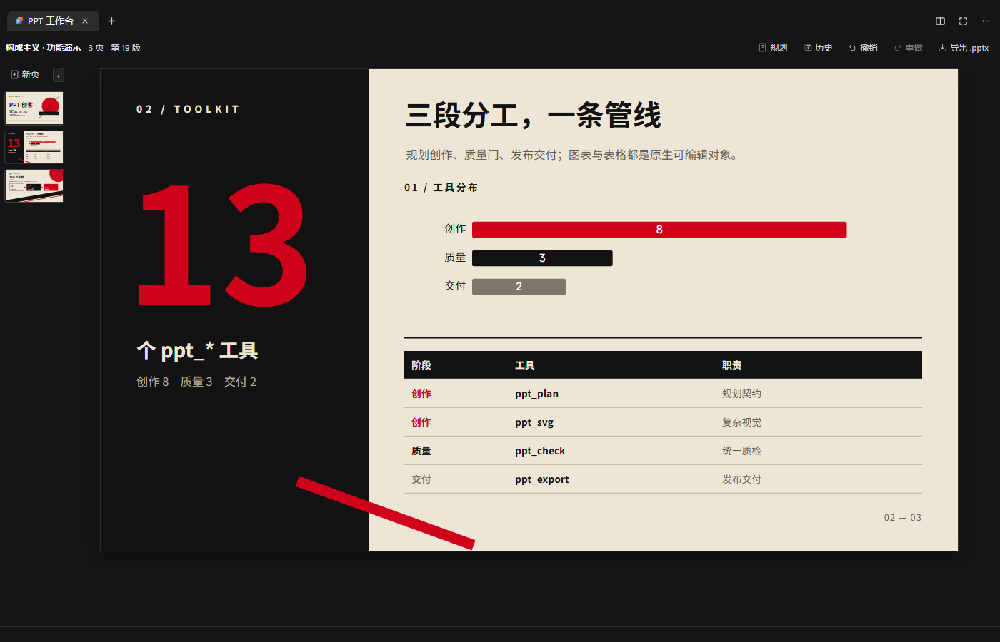
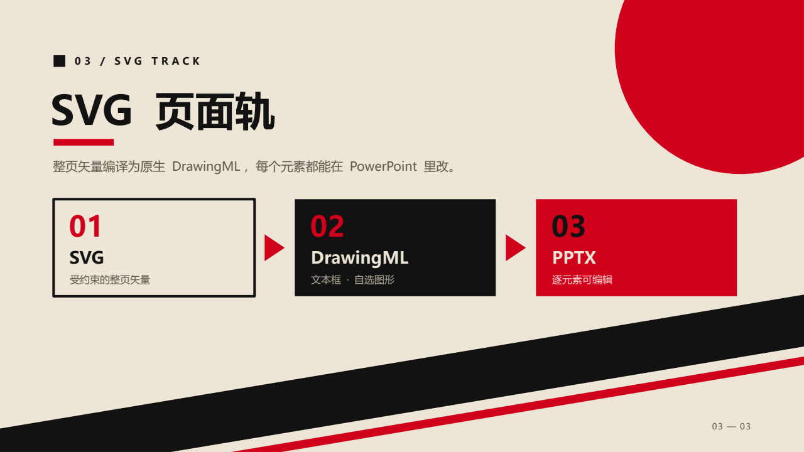

<p align="center"><a href="README.md">中文</a> · <strong>English</strong></p>

<div align="center">
<h1><br>PPT Maker (dsh-ppt-maker)</h1>

  <p>A DeepSeek Harness plugin for creating, editing, reverse-engineering, checking and exporting presentations — a local, pure-TypeScript engine builds the final .pptx directly.</p>
  <p>The model works through thirteen <code>ppt_*</code> tools while you follow along and edit in the right-hand workbench — double-click to edit text in place, drag to reorder pages, and open the exported file with one click.</p>

  <p>
    <a href="https://www.npmjs.com/package/dsh-ppt-maker"></a>
    <a href="https://github.com/deepseek-ai/dsh"></a>
    <a href="LICENSE"></a>
    <a href="https://github.com/OMSociety/dsh-ppt-maker/stargazers"></a>
    <a href="https://github.com/OMSociety/dsh-ppt-maker/issues"></a>
  </p>

<a href="#what-this-is">What This Is</a> • <a href="#key-features">Key Features</a> • <a href="#in-action">In Action</a> • <a href="#installation">Installation</a> • <a href="#model-tools">Model Tools</a> • <a href="#the-workbench">The Workbench</a> • <a href="#development">Development</a> • <a href="#changelog">Changelog</a> • <a href="#support--acknowledgements">Support &amp; Acknowledgements</a> • <a href="#license--author">License &amp; Author</a>
</div>

## What This Is

**PPT Maker** is a presentation toolchain that lives inside DeepSeek Harness: the model creates, edits, reverse-engineers, checks and exports decks through thirteen `ppt_*` tools, while you work alongside it in the right-hand workbench — panel and model read and write the same PPTD project.

The intermediate format is **PPTD**, a self-defined contract in YAML (`deck.pptd` + `pages/*.page`): self-contained per page and WYSIWYG, with two dialects (generate / reverse superset). The full spec is in [`docs/pptd-spec.md`](docs/pptd-spec.md) (fully self-contained).

## Key Features

| Feature | Description |
|---|---|
| **Thirteen model tools** | Registered with raw JSON-Schema: create / themes / plan / edit / undo / redo / render / check / export / import / open / surgical patch / SVG. The engine `@office-kit/pptx@0.24.0` builds the final .pptx locally in pure TypeScript — no Python in the main pipeline |
| **Planning contract** | `brief.md` (purpose / audience / core message) + `plan.yml` (page plan: track / intent) are first-class project artifacts; `ppt_plan` reads and writes them, and the workbench plan drawer shows the same data; early pages P01–P05 are rendered for confirmation before the full deck is built |
| **SVG page track** | Pages with `pageType: svg` compile a whole SVG page into native DrawingML (text boxes / freeform shapes, element-editable in PowerPoint — not a pasted image), built, checked and exported through the same pipeline as native pages; `ppt_svg` writes and compiles, with artifacts cached by content + converter version + theme hash. The converter is vendored from ppt-master (MIT); prepare its environment with `node scripts/prepare-vendor-env.mjs` |
| **Masters & layouts** | `deck.masters` declares real OOXML masters/layouts (shared decorations + placeholder frames); pages attach via `layoutRef`, so shared decorations across a multi-page deck are declared once |
| **Two-way workflow** | `ppt_import` reverse-engineers an existing .pptx into a PPTD project and archives the source file; a deck with zero edits since import is restored wholesale from the source archive on export (charts / SmartArt / connectors survive), and any content edit falls the whole deck back to a rebuild; `ppt_patch` performs surgical edits on a .pptx (text / image / page order) without a PPTD round-trip |
| **PPTD contract** | A YAML DSL (`deck.pptd` + `pages/*.page`), self-contained per page and WYSIWYG; generate / reverse dialects, editable by hand and by machine |
| **Right-hand workbench** | A custom three-pane editor (thumbnails + canvas + inspector): double-click to edit text in place, drag to reorder pages, one-click image replacement, live table/chart rendering, whole-page SVG preview, plan drawer, undo / redo, version history with live snapshot preview and one-click restore, 409 conflict protection and a "modified externally" banner |
| **Layered QA** | Rule layer (text overflow measured with real glyph widths / out-of-bounds / overlap / per-run contrast / structure / missing fonts) blocks export; AI layer on demand (`ppt_check ai:true`) sends rendered page PNGs to a multimodal model to review color and layout — suggestions only, never blocking; results are recorded in `manifest.qaReport`, fingerprint-bound to deck + pages + plan + media + checker and converter versions — a stale or partially-covering report refuses export |
| **Unified release pipeline** | Model export and panel export share one release pipeline: QA gate → build + font embedding → postflight re-read (ZIP re-parse + library validation) → SHA-256 ledger |
| **Font embedding** | Export embeds the fonts actually used (EOT-wrapped `fntdata` + `embeddedFontLst`), so machines without the fonts installed render without falling back; subset / whole-font / off tiers (`export.fontEmbed`), with a per-font fsType license gate |
| **Transitions & animations** | Page-level transitions (fade by default / none / auto curated rotation) and 95 element animation presets, written natively by the local pipeline |
| **Revisions & snapshots** | Single-writer manifest + append-only snapshots (the cursor model makes undo/redo natural) + baseRevision optimistic locking (409) |
| **Design system** | Five preset theme families with 30 themes — academic / consulting / finance / promotion / work; machine-readable `theme.yml` (colors / fonts) is written into `deck.theme` on selection, keeping the whole deck's layout, color and hierarchy consistent |
| **Locally rendered preview** | The canvas and thumbnails render PPTD pages directly to the DOM (vector, instant, same coordinate system as the selection boxes); PNG previews for export and QA rasterize the final pptx via `@deepseek-ai/libreoffice-kit`, written to the project's `.previews/page-NN.png` and overwritten on each render; `ppt_render` lists each page image's absolute path for `read_image` |

## In Action

### Light workbench · Cover



### Dark workbench · Native chart and table



### Actual export · SVG page track



Both workbench images render the production client components, styles and real three-page PPTD data, replacing only network transport with a local fixture. [`docs/preview/workbench.html`](docs/preview/workbench.html) is self-contained and opens offline; use `#theme=light&page=0` or `#theme=dark&page=1` to select the theme and page. The third image is an actual render of the final PPTX for page three of the same project.

## Installation

**Install from npm**

```powershell
# Stop the running DSH first (a running service locks dependencies; start it again afterwards)
dsh plugin --profile <profile> add "dsh-ppt-maker"
```

> **Tip:** after installing, refresh the browser page and open the "PPT 工作台" tab from the right-hand rail — restarting the host alone is not enough, the client bundle is fetched when the page loads.

> **Dependencies:** the main pipeline is pure TypeScript with no Python; `@deepseek-ai/libreoffice-kit@0.1.2`, used by `ppt_render` and QA, is a hard dependency (about 183MB per platform, installed with the package). Only the SVG page track (`ppt_svg`) needs Python 3.10+: run `node scripts/prepare-vendor-env.mjs` once (the script ships with the package, at the plugin package root) to create the virtual environment and install the pinned dependencies (pip uses the Tsinghua mirror by default; override with the `PIP_INDEX` environment variable, and pick the interpreter with `PYTHON`). The Python scripts under `skills/ppt-maker/scripts/` are an escape hatch only — see the "Python escape hatch" section in SKILL.md.

> **Platforms:** the engine ships per platform. Windows (x64/arm64) and macOS (x64/arm64) get native packages; Linux has none (no `libreoffice-kit-linux-*` on npm), so rendering and QA fall back to WASM. CI runs the same suite on `windows-latest` and `ubuntu-latest` (minus the font-embedding assertions) and both pass; exports are produced by the same code path, without a cross-platform byte comparison. macOS has no CI coverage yet.

**Getting started**

1. Say "make me a presentation" in the chat (or explicitly invoke the `ppt-maker` skill) → the thirteen `ppt_*` tools come in
2. The model writes the brief and page plan with `ppt_plan` (early pages P01–P05 are rendered for your confirmation), creates a project with `ppt_create`, or reverse-engineers an existing .pptx into a project with `ppt_import` → the workbench pops open in the right-hand rail
3. Double-click to edit text in the panel, drag to reorder pages, click "Export .pptx" → the plugin runs a full-deck rule check on the spot, then saves `<project>-r<version>.pptx` under the project's `export/`
4. Have the model run `ppt_check` for QA and `ppt_render` for per-page PNGs; if the model edits the same project in another session, the panel shows a 409 conflict banner instead of overwriting your edits
5. Click "Open" in the footer status bar → open the result with the system associated app, or choose "Show in folder"

## Model Tools

| Tool | What it does | Key parameters |
|---|---|---|
| `ppt_create` | Create a new PPTD project (selected theme written into `deck.theme`) | `dir` · `title` · `size` · `designSystem` · `theme` |
| `ppt_themes` | List design systems and themes (five families, 30 themes) | `designSystem` (optional) |
| `ppt_plan` | Read/write the planning contract: brief (purpose / audience / core message) and plan (page plan) | `dir` · `action` (`get`/`setBrief`/`setPlan`) |
| `ppt_edit` | Atomic editing: an ops array of page/element additions, removals and updates (incl. `update_plan` / `update_svg_source`), with baseRevision optimistic locking | `dir` · `ops` · `baseRevision` |
| `ppt_undo` / `ppt_redo` | Undo / redo (cursor moves; consecutive edits within the merge window count as one step) | `dir` · `steps` (1–20, default 1) |
| `ppt_render` | Render per-page PNG previews (rasterization of the final pptx; the result lists each page image's absolute path) | `dir` · `pages` · `dpi` (default 96) |
| `ppt_check` | Rule-based QA (default) + AI visual QA (suggestions only, never blocking) | `dir` · `pages` · `ai` |
| `ppt_export` | Export .pptx (QA fingerprint gate + postflight re-read; `skipCheck` bypasses) | `dir` · `out` · `skipCheck` |
| `ppt_import` | .pptx → full PPTD reverse engineering (dropped / degraded two-level report + source archive) | `source` · `targetDir` · `mode` (`full` / `surgical`) · `open` |
| `ppt_open` | Have the right-hand workbench open a project | `dir` |
| `ppt_patch` | Surgical edits on a .pptx: set_text / replace_image / move_page | `source` · `ops` · `out` |
| `ppt_svg` | SVG page track: write SVG source (`put`) / compile to a native DrawingML single page (`compile`) | `dir` · `action` · `name` · `svg` · `page` |

The model's standard sequence is **`ppt_plan` (brief/plan) → `ppt_create` (or `ppt_import`) → `ppt_edit` iterations (`ppt_svg` for complex visual pages) → `ppt_check` → `ppt_export`**; the `ppt-maker` skill (registered with the plugin) documents the design-system selection and editing discipline, which the model reads on demand. For light edits to an existing .pptx (text / image / page order), use `ppt_patch` — no PPTD round-trip involved.

> **Tip:** when export is blocked by a rule blocker, fix the `issues` returned by `ppt_check` one by one, or force it with `skipCheck:true` (not recommended). If `ppt_check ai:true` returns `ai.performed:false` plus a list of PNG paths, the current route's model doesn't accept image input — the main model can review those PNGs itself with `read_image`.

## The Workbench

The "PPT 工作台" tab in the right-hand rail is a three-pane editor: thumbnail strip + canvas + inspector.

- **The canvas is the DOM**: the canvas and thumbnails render the PPTD page AST directly to the DOM (`client/components/PptdView.tsx`) — instant, no libreoffice cold start; elements, selection boxes and the in-place editor share one coordinate system and stay aligned. Tables and charts render as real DOM/SVG; SVG pages preview as a full-page backdrop; elements that can't render yet (icon / SmartArt) show gray placeholders.
- **Plan drawer**: the "Plan" toolbar button opens a read-only drawer showing brief.md and plan.yml (page file / title / track / intent).
- **Collapsible side panes**: the left page list is expanded by default and can be collapsed; the right inspector only expands when an element is selected. Collapsed panes leave only an edge handle.
- **Edit in place**: double-click to edit text / drag to reorder pages / duplicate, delete and add pages / replace images / "Export .pptx" runs the rule check automatically and saves `<project>-r<version>.pptx` under the project's `export/`.
- **Version history**: the "History" drawer renders any snapshot live on the canvas and restores it with one click.
- **Footer status bar**: "Saving…" and operation feedback (export destination, failure reasons) live in a permanent bottom bar that doesn't eat canvas height.
- **Conflict protection**: every write carries `baseRevision`; if the model edits the same project in another session the server returns 409 — the panel only shows a conflict banner and never overwrites your edits; the "modified externally" banner works the same way.
- **Polling and focus**: state is polled every 3s to watch manifest.revision; after the model finishes `ppt_open` / `ppt_import`, the panel focuses the corresponding project automatically.

## Development

```powershell
npm install          # install dependencies
npm test             # full regression suite (set a 12GB heap and run serially, see below)
npm run typecheck    # two tsconfigs: src/ and client/
npm run build        # rebuild lib/index.js and lib/client.js (required after touching src/ or client/; commit the artifacts)
npm run build:preview # rebuild the self-contained preview HTML from production workbench components and docs/preview/fixture.json
npm run check:build  # verify lib/ matches git
npm run check:mounts # mount declaration check
npm run check:pack   # package file-list check
```

> **Tip:** the full test suite needs a large heap and serial execution (the default heap runs out of memory): set `$env:NODE_OPTIONS='--max-old-space-size=12288'` first, then `npx vitest run --no-file-parallelism`. The full acceptance criteria and the don'ts are in [`AGENTS.md`](AGENTS.md).

Directories and where to make changes:

```text
src/index.ts       host entry: registers the skill + lazily expands the 13 tools + webServer prefix routes
src/core/          engine: pptd contract / officekit builder / project store & snapshots / reverse / QA / font embedding / release pipeline / svg compile bridge
src/tools/         raw JSON-Schema contracts of the 13 tools
client/            right-hand workbench source (TSX → esbuild bundles lib/client.js)
plugin/            loading shell + host routes (plain JS, core injected via deps.core)
skills/ppt-maker/  the ppt-maker skill: design-system reference and generation discipline (the model reads it on demand); vendor/ holds the SVG converter and its Python environment
tests/             host contract / tool e2e / reverse / fonts / bundle guards (20 anonymized corpus .pptx files are committed; sensitive-words.txt is not)
docs/              PPTD spec (fully self-contained) / decision log / fallback font table
lib/               build artifacts (committed; dsh plugin add installs without building)
```

## Changelog

See [CHANGELOG.md](CHANGELOG.md).

## Support & Acknowledgements

- If this plugin helps you, a star is much appreciated; for questions and suggestions please open an [Issue](https://github.com/OMSociety/dsh-ppt-maker/issues) or a [Pull Request](https://github.com/OMSociety/dsh-ppt-maker/pulls). Development conventions are in [`AGENTS.md`](AGENTS.md).
- Built on the [DeepSeek Harness](https://github.com/deepseek-ai/dsh) plugin / skill system.
- Engine [@office-kit/pptx](https://www.npmjs.com/package/@office-kit/pptx) (pinned at 0.24.0) and preview [@office-kit/pptx-preview](https://www.npmjs.com/package/@office-kit/pptx-preview); rasterization via [@deepseek-ai/libreoffice-kit](https://www.npmjs.com/package/@deepseek-ai/libreoffice-kit) (MPL-2.0 — its API / CLI is invoked only, no source linking or modification).
- The SVG → DrawingML converter is vendored from [ppt-master](https://github.com/hugohe3/ppt-master) (MIT, © 2025-2026 Hugo He); the planning-contract and quality-gate workflow design is also inspired by it. Third-party license details are in [THIRD_PARTY_NOTICES.md](THIRD_PARTY_NOTICES.md).

## License & Author

[MIT](LICENSE). © 2026 [OMSociety](https://github.com/OMSociety).
